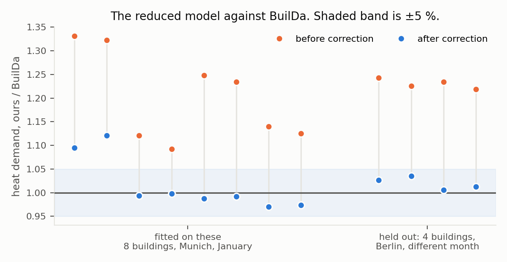
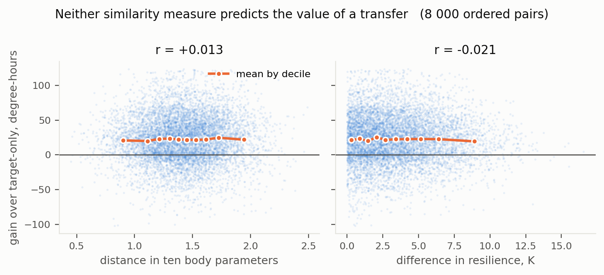
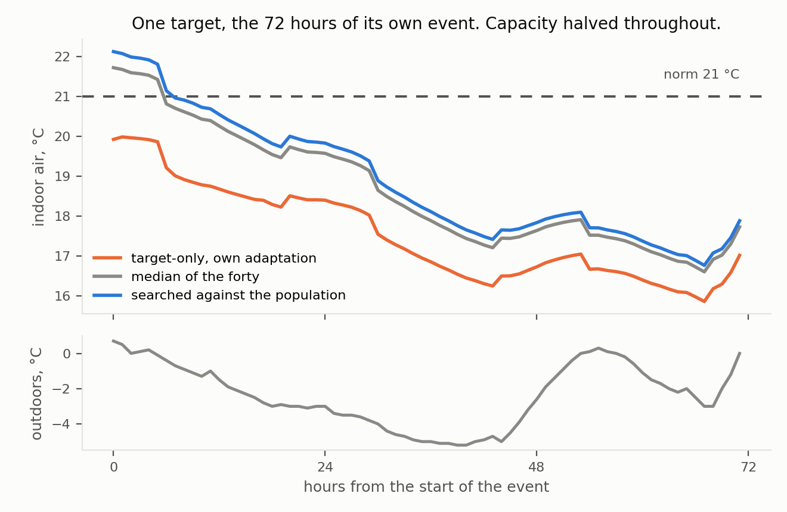
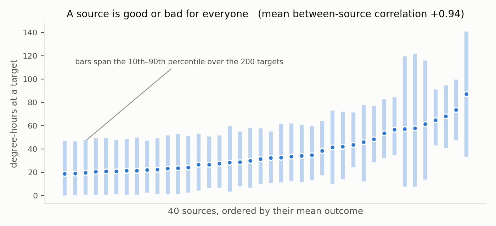
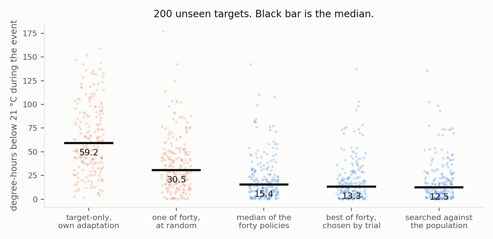
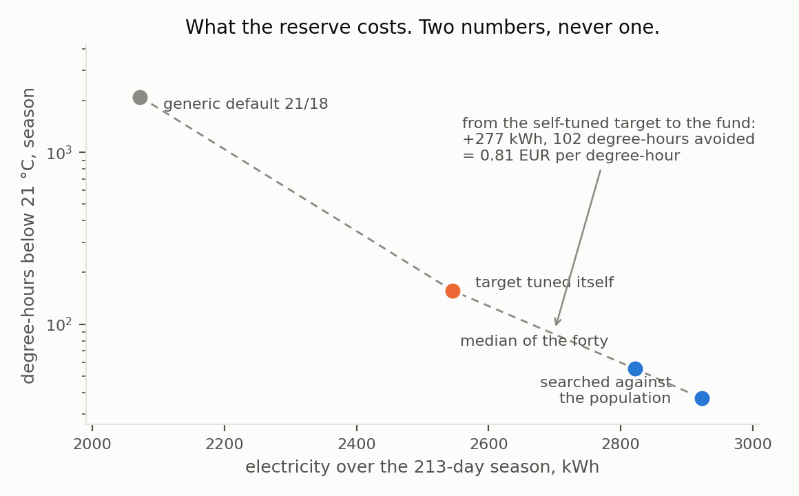

# Source selection does not survive a wider population: a null result on 200 targets across 19 climates, and what replaces selection

Evgenii Bogomazov-Pusser · independent researcher, Rehovot, Israel · evgeniipusser88@gmail.com · ORCID 0009-0004-7834-1486

Draft, September 2026. Code and data are open; every figure is written by the script that produces it.

## Abstract

Choosing which building to transfer from is a recognised open problem in transfer learning for building thermal dynamics. Recent work narrows it in two ways: a general model pretrained on many sources is offered as a way to remove the choice altogether [1], and a systematic study over 243 source buildings finds that similarity in wall U-value predicts fine-tuning success, while cautioning that similar parameters need not imply similar dynamics [2].

We report the same question asked under a wider population and a different measure. The inherited object is a control policy rather than a predictive model; the loss is degree-hours below the comfort norm and electricity consumed during a 72-hour heating failure located at the coldest window of the target's own year; and the population spans 200 targets and 40 sources drawn from measured weather for 19 locations, 32 city-years, between Rome and Chicago. The bench is a reduced three-capacity model calibrated against BuilDa [3] on eight buildings and checked on four held out in another city and month, agreeing to 2 % on heat demand and 0.23 K on mean indoor temperature.

Under those conditions no measure of similarity predicts the value of a transfer. Correlation of transfer gain with distance in ten body parameters is +0.013 over 8 000 ordered pairs; with difference in a physically motivated resilience trait — indoor temperature after 72 hours with the heating off at −10 °C — it is −0.021. Since the 8 000 pairs are 40 rows by 200 columns and not 8 000 independent observations, both are tested by permuting whole targets: p = 0.82 and p = 0.36. Selecting the nearest source by either measure is worse than selecting at random: 35.1 and 35.4 degree-hours against 26.8.

The reason is that the sources are not paired with the targets at all. The correlation between sources, over their outcomes across targets, is +0.94: a source is good or bad for everyone. Decomposing the gain matrix, 67 % of its variance is which target received the policy, 26 % is which source produced it, and 6 % is their combination — the only part any similarity measure could ever explain. In consequence, a per-target oracle would improve on simply giving every target the single best source by 0.2 degree-hours out of 19.0, one per cent. There is no matching problem of a size worth solving, which is why no trait solves it.

Two controls support this rather than the alternative reading, that our policy is too poor an object to carry a pairing. Repeating the experiment with a twenty-six-parameter policy — twenty-four hourly setpoints in place of five shape parameters — raises between-source concordance to +0.978 and lowers the combination term to 3.7 %. The richer the inherited object, the less there is to match.

What does work is selection by trial rather than by description. A source chosen as best on one random half of the targets loses nothing on the other half, in 200 random splits, and beats the population median in every one. Going further, a single policy searched directly against the whole model population beats both the median of the sources' own solutions (12.5 against 15.4 degree-hours, better for 98 % of targets) and the best individual solution among them, which it was not constrained to reproduce.

We also state the price, which is not small. Against a target that tuned itself, the inherited policy costs 277 kWh more over a 213-day season, about 83 EUR at 0.30 EUR/kWh, and buys 102 degree-hours of avoided discomfort — 0.81 EUR per degree-hour — of which 42 % falls inside 1.4 % of the season.

We report one defect of our own procedure: the direct population search was given discomfort as its sole objective and no price for energy, so its setpoint rose to the bound we imposed. Its ordering against the other conditions stands; its parameter values should not be quoted as a recommendation.

## 1. The question, and why our answer differs from the published one

Transfer between buildings works, and negative transfer is recognised [4]. Which source to use is the part that is open. Two recent results frame it.

Raisch et al. [1] pretrain a single LSTM on 450 simulated buildings and fine-tune it on thirty days of a target, obtaining a 42.1 % reduction in prediction error against fine-tuning single-source models, and state that the general model "eliminates the need for source-building selection by serving as a universal source for fine-tuning."

Krug et al. [3] address the selection problem directly. Varying five parameters of 243 source buildings and fine-tuning each to two target buildings — 486 models in all — they find that wall U-value dominates fine-tuning success, that closer values help, and that for the low-inertia target window U-value matters too. They are explicit about the limits: "similar building parameters might not necessarily imply similar thermal dynamics," "it remains unclear which building parameters are most critical," and comprehensive studies over more targets and more climates "are very much needed."

The same group has also examined how a single building's own dynamics drift over its life, and compared transfer learning with continual learning under that drift [5]. The work here is the other axis: not one building over time, but many buildings at one moment.

The same group has since shown why the measure matters as much as the source. Models that predict indoor temperature very well can fail when placed inside a model predictive controller, so prediction accuracy is not a proxy for control performance [10]. Everything reported here is therefore measured on the control task directly: what the building spends and how cold it gets, never the error of a forecast.

Our experiment is that wider study, with three differences that matter and are stated here rather than discovered later:

| | Krug et al. [3] | this work |
|---|---|---|
| target buildings | 2 | 200 |
| weather | Munich, one TMY | 19 locations, 32 city-years |
| varied in sources | 5 parameters | 10 parameters and climate |
| inherited object | LSTM weights (a model of the body) | a control policy: five schedule parameters |
| measured quantity | RMSE of indoor temperature | degree-hours below norm and kWh, inside a failure |
| failure modelled | none | heating capacity halved for 72 h |
Table 1. The two experiments side by side.

We find no similarity signal. We do not read that as contradicting [3]. A trend visible across two targets under one sky can disappear when the population is widened, and that is a finding about the trend's reach rather than about its existence. Section 7 returns to this.

## 2. The bench, and what it is answerable to

### 2.1 Model

A single zone with three thermal capacities — air with furniture, envelope, internal partitions — connected by conductances derived from surface areas and U-values with an interior film coefficient of 2.7 W/m²K. Within each 15-minute control interval the system is linear and the state is advanced by the matrix exponential, so no integration-step artefact exists by construction.

Weather is read from `.mos` files: dry-bulb temperature, direct normal and diffuse horizontal radiation. Solar gain is computed on four vertical facades from the true solar position at the file's latitude, with beam, isotropic diffuse and ground-reflected components.

Heating is by an air-source heat pump. Its coefficient of performance follows a heating curve and falls with outdoor temperature, and — the point that matters here — so does its **available capacity**, by a linear fit anchored at full nominal output at 7 °C and 60 % at −10 °C. Nominal power is sized by the rule used in BuilDa's own converter layer, following DIN 18599-2 including the 0.6 ground-coupling factor of DIN 4108-6 [8], at a design outdoor temperature taken as the 0.4th percentile of that location's record. For Munich the percentile gives −12.5 °C against the −14.2 °C printed in the file's ASHRAE header, which is the check on the method.

The consequence is not tuned: a building in the coldest window of its own year can already deliver only 88–95 % of the heat it needs, before any failure is applied.

### 2.2 Calibration

BuilDa [3], the generator released alongside the ThermBuild dataset of 960 buildings [7], is an open, configurable single-zone Modelica model solved by CVODE, validated against the ASHRAE 140-2004 test cases TC600, TC900, TC600FF and TC900FF [9], with results inside the reference ranges of established tools. We used it as the reference for our reduced model.

Eight buildings spanning wall U-values of 0.2–0.665 W/m²K, window U-values of 1.0–3.2 W/m²K and two or three storeys were simulated for thirty days of January in Munich, in BuilDa and in the reduced model, with identical geometry, fabric, controller, setpoint schedule and weather. A single pair of correction factors — one on the envelope conductance, one on windows plus ventilation — was fitted on those eight. The factors were then applied unchanged to four buildings not in the fitting set, with different U-values, in Berlin, in a different month.

Figure 1. Heat demand of the reduced model divided by BuilDa's, for the same twelve buildings, before and after the two correction factors; 1.00 would be exact agreement. The four on the right were not in the fitting set and are in another city and another month. After correction the mean ratio is 1.016 on the fitting set and 1.020 held out, the worst single building is 12.1 % and 3.5 % out, and mean indoor temperature differs by at most 0.20 K and 0.23 K.

The envelope factor of 0.65 has a physical counterpart: BuilDa applies the DIN 4108-6 reduction of 0.6 for heat flow to the ground, which our uncorrected model did not.

The reduced model simulates a heating season for three hundred buildings at once in about a second, roughly four thousand times faster than the reference. The two are complementary: the fast model performs the hundreds of thousands of season evaluations a search protocol needs, and the reference states what those evaluations are worth.

### 2.3 Season, event and protocol

The season runs 1 October to 30 April, so that a newly commissioned building meets its first winter with an autumn behind it. The event is located by the record, not chosen: the 72-hour window whose mean outdoor temperature is lowest in that building's own year, found by search over its weather file, with available heating capacity halved inside it.

The primary measure is degree-hours below 21 °C **within that window**, in absolute units. The window is 1.4 % of the season and holds roughly a third of the season's discomfort, which is why measuring over the year divides the effect away.

Sources live their own year once with a search budget of 400 season evaluations and see their own event. Targets adapt only on hours preceding their window: a target allowed to adapt during the event would be living it twice. Sources and targets draw their years from disjoint halves of the pool, so a target's event is never a source's event.

A note on the cost function used inside the search. Discomfort is counted as degree-hours below 21 °C with no tolerance. An earlier version allowed 0.5 K of tolerance, and sources learned to hold the indoor temperature exactly at the edge of it: penalty zero, energy minimal, reserve zero. That is an exploitation of the measure rather than a skill, and the tolerance was removed. Where energy and discomfort are reported together in this paper they are reported as two numbers, never as one weighted sum.

## 3. No trait predicts the value of a transfer

Forty sources, two hundred targets, all 8 000 ordered pairs evaluated.

Two similarity measures are compared. The first is our earlier one: Euclidean distance in ten standardised body parameters — wall, roof, floor and window U-values, window fraction, air change rate, wall and partition heat capacities, floor area, installed power. The second is a single physically motivated trait, and it is the one this experiment was built to test: **resilience**, defined as the indoor air temperature after 72 hours with the heating off and −10 °C outside, starting from a heated steady state. It is a property of the body alone — no schedule enters it — and it correlates at 0.97 with the building time constant, total capacity over effective conductance.

An earlier form of that probe, hours for the air to fall from 21 to 19 °C, was discarded before use: the air capacity is small, the air falls through 19 °C within the first hour in every building, and the probe measured the air node rather than the building.

| | median | mean | worst | better than target-only |
|---|---|---|---|---|
| target-only, own short adaptation | 56.0 | 59.4 | 168.5 | — |
| one source chosen at random | 26.8 | 37.5 | 155.7 | 76 % |
| nearest source by body parameters | 35.1 | 39.4 | 159.6 | 71 % |
| nearest source by resilience | 35.4 | 41.1 | 141.2 | 72 % |
| median over all sources | 17.2 | 23.8 | 109.3 | 90 % |
| best available source, in hindsight | 12.1 | 18.8 | 96.7 | 99 % |
Table 2. Degree-hours below 21 °C during the 72-hour event. 200 targets.

Figure 2. Transfer gain against two measures of similarity, all 8 000 ordered pairs. Orange marks the mean within each decile of the abscissa; both lines are flat.

Over the 8 000 pairs, the correlation of transfer gain with distance in body parameters is **+0.013** and with difference in resilience **−0.021**.

Those 8 000 pairs are not 8 000 independent observations: they are 40 source rows by 200 target columns, and a test that treats them as independent understates its own p-values. We therefore permute whole targets — which destroys the source–target correspondence while preserving both the differences between sources and the differences between targets — and recompute the correlation 5 000 times. The two-sided permutation p-values are **0.82** and **0.36**, against 0.25 and 0.06 under the naive test. The second measure, which under the naive test looked marginal, is not marginal at all. The sign of that correlation is also the wrong way round for a similarity effect — a larger difference goes with a marginally larger gain — which is what a null looks like rather than a finding. Choosing the nearest source by body parameters beats choosing at random for 44 % of targets; by resilience, for 45 %. Both are a coin.

Both forms of selection are worse than no selection: 35 degree-hours against 27 for a random source, and against 17 for the median over all of them. Selecting actively harms.

Figure 3. One target — a Paris year, the median target by its own adaptation's outcome — through the 72 hours of its own event, with heating capacity halved throughout. The inherited policies hold about 1.3 K above what the building reaches on its own, for three days. None of them keeps it at the norm.

The last row of Table 2 makes the harm concrete. A source exists that would have served almost every target well — 12.1 degree-hours, better than target-only for 99 %. The material is there. Nothing in the description of a source or of a target points at it.

## 4. Why: the sources are not paired with the targets

The null result of Section 3 has a single-line explanation that we did not anticipate and that can be read off the same matrix.

Take the 40 × 200 matrix of outcomes and correlate the sources with one another across targets. The mean pairwise correlation is **+0.94**. A source that does well for one target does well for nearly all of them. The ranking of sources barely depends on which target they are given to.

Figure 4. Each source's outcome across the 200 targets, sources ordered by their mean. The spread between sources is far larger than the spread of any source across targets, which is what a between-source correlation of +0.94 looks like.

Consistently: of forty sources, only four were ever the best for any target, and two of those were best for 187 targets of 200.

**The number is stable.** Resampling the 200 targets with replacement puts the mean between-source correlation in [+0.921, +0.953]; using only half the sources, in [+0.923, +0.958]. On ranks it is +0.901 by Spearman, and Kendall's coefficient of concordance over the forty sources is 0.896. It is not an artefact of two hundred particular buildings, nor of a few outlying pairs.

**How much is available to a similarity measure at all.** Decompose the 200 × 40 gain matrix into a target main effect, a source main effect and their interaction. The target term holds 67.3 % of the variance, the source term 26.4 %, the interaction 6.3 %. Only the interaction can be predicted from a similarity between a source and a target; the other 94 % is a property of one or the other alone. Within that interaction, distance in body parameters accounts for 0.09 % and difference in resilience for 1.07 %. This converts the null result from an absent correlation into a measured ceiling.

**What perfect matching would be worth.** The practical form of the same statement. Giving every target the single source that is best on average over the population yields 19.0 degree-hours; giving every target the source that is best for it, chosen with hindsight, yields 18.8. Perfect selection is worth 0.2 degree-hours, one per cent. For 62 % of targets the universally best source already is their individual best; the median target loses exactly nothing by taking it, and even at the 99th percentile the loss is 2.3 degree-hours. Splitting the population into its extreme thirds by resilience or by installed power per square metre does not change this: concordance stays between +0.88 and +0.97 and the correlation with body distance changes sign between subgroups, which is what noise does.

**Is this an artefact of a five-parameter policy?** It is the obvious objection: if the inherited object has one dominant axis — how much reserve to hold — then near-unit concordance is close to forced by construction, and the null result would be about our parameterisation rather than about buildings. We repeated the experiment with the same population, the same event and the same search budget per source, but with a twenty-six-parameter policy: twenty-four hourly setpoints indexed from each building's own occupancy hour, plus the deadband and the gain. The richer object contains the poorer one, since a schedule of hourly setpoints can raise the setpoint early and so express preheating without a preheating parameter.

| | 5 parameters | 26 parameters |
|---|---|---|
| mean between-source correlation | +0.939 | +0.978 |
| interaction share of the gain variance | 6.3 % | 3.7 % |
| value of perfect per-target selection | 1 % | 5 % |
| correlation of gain with body distance | +0.013 | +0.012 |
Table 3. The same population and the same event under a poorer and a richer inherited object.

The objection is answered in the direction opposite to the one it assumes. Enriching the inherited object does not create a pairing; it concentrates the outcome further on the source alone. One honest qualification: with richer policies the identity of the best source becomes less stable — fifteen sources of forty were best for someone, against four — but the cost of getting that choice wrong remains about one degree-hour in twenty.

So there is no pairing to discover. "Which source suits this building" is not a well-posed question in this population, because suitability is almost entirely a property of the source alone. Any procedure that searches for a match is searching for something that is not there, and the effort spent matching is what makes selection worse than chance.

This also explains, without contradiction, why a similarity trend is visible in [3] and not here. Their two targets sit at opposite edges of a distribution in which five parameters vary and the sky is the same for everyone; the pair term is then a larger share of what remains. Widen the population — ten parameters, nineteen climates, two hundred targets — and the source term dominates the pair term so completely that nothing is left to correlate with.

## 5. What works instead

### 5.1 Selection by trial

If suitability is a property of the source, it can be measured by trying the source out, and the trial generalises.

We split the 200 targets into two random halves 200 times. On each split, the source with the lowest mean loss on the first half was applied to the second.

| | degree-hours on the unseen half |
|---|---|
| source chosen on the other half | 18.9 (spread 1.5) |
| best possible source on that half | 18.9 |
| median over all sources | 23.7 |
| source chosen at random | 37.2 |
Table 4. Selection by trial, 200 random splits of 200 targets.

The loss from having chosen blind is zero to the first decimal. The chosen source beat the median over all sources in 100 % of splits, and a random source in 100 %.

This is not a statement about buildings. It is the arithmetic consequence of Section 4: when the concordance between sources is +0.94, a sample suffices to rank them.

The trial costs nothing when it is run on a model population. It costs a great deal when run on occupied buildings — in our runs, a bad source leaves a target with 87 degree-hours of discomfort against 19 for a good one. That is the practical content of the result: the value of a simulated population is not that it supplies records, but that candidates can be tried on it without anyone being cold.

### 5.2 A policy searched against the population beats the median of the population's own policies

If what matters is a source's own quality rather than its fit, then aggregating the sources' individual solutions is the wrong operation, and searching directly for one solution that serves the population is the right one. We compared them under an equal budget of 400 season evaluations.

Forty model buildings; two hundred targets that neither procedure saw.

| | median | mean | worst | better than target-only |
|---|---|---|---|---|
| target-only, own short adaptation | 59.2 | 63.3 | 159.0 | — |
| one of the forty, at random | 23.9 | 31.8 | 136.7 | 82 % |
| median of the forty policies | 15.4 | 22.2 | 142.1 | 93 % |
| best of the forty, chosen by trial | 13.3 | 19.8 | 137.2 | 98 % |
| policy searched against the population | 12.5 | 19.3 | 135.3 | 100 % |
| best of the forty, in hindsight | 13.2 | 19.4 | 136.1 | 99 % |
Table 5. Degree-hours below 21 °C during the event, 200 unseen targets.

Figure 5. The five conditions on 200 unseen targets, one point per target, black bar at the median. Orange: no inheritance or an unchosen source. Blue: the three forms of inherited policy.

The directly searched policy is better than the median of the forty for 98 % of targets, better than the best of the forty for 82 %, and better than every target's own adaptation for 100 %. It is also better than the best of the forty individual solutions — that is, it found a policy none of the forty buildings had reason to find, because none of them was solving the population's problem.

The shape of this result agrees with [1], reached on a different inherited object and a different measure: one thing learned against many sources beats any aggregation over what the sources learned for themselves.

### 5.3 What the searched policy contains

| | generic default | median of the forty | searched against the population |
|---|---|---|---|
| occupied setpoint, °C | 21.0 | 23.6 | 24.0 |
| night setback to, °C | 18.0 | 21.0 | 21.0 |
| preheating lead, h | 1.0 | 2.05 | 2.70 |
| deadband, K | 0.50 | 0.19 | 0.10 |
| controller gain | 0.35 | 0.49 | 0.79 |
Table 6. Three policies.

Both inherited policies abandon the night setback entirely, hold above the norm, narrow the deadband and raise the gain. Across the forty sources the learned setback depth ranges from 8.6 K to zero; the median selects those that abandoned it.

Neither element is new to practice, and we claim no novelty for the rule. Compensating supply temperature against outdoor temperature is standard in heat-pump controllers, and advice against night setback for heat pumps in cold weather is routine installer guidance. The contribution is the provenance: the bench was told nothing about heat pumps, setbacks or installer practice, and the rule emerged from sources that had each survived a different failure. A bench that independently reproduces an answer the field already holds earns some confidence where the field holds none — which is the question of the next section, how much reserve and at what price.

The searched policy's occupied setpoint of 24.0 °C is the upper bound we imposed on the search, and the search reached it. The reason is a defect in our objective rather than a property of the problem: the direct search was given discomfort alone and no price for energy, so it had nothing to trade against comfort. The ordering in Table 6 stands, because all conditions are evaluated on the same two measures afterwards. The parameter values in the last column of Table 6 should not be read as a recommendation.

## 6. The price

Energy and discomfort are reported separately, because the weight between them is a judgement and not a measurement.

Two hundred targets, whole 213-day season, medians:

| | electricity, kWh | degree-hours below 21 °C, season | of which inside the event |
|---|---|---|---|
| generic default 21/18 | 2 072 | 2 104 | 80.9 |
| target tuned itself | 2 545 | 157 | 58.5 |
| median of the forty | 2 822 | 55 | 15.4 |
| searched against the population | 2 923 | 37 | 12.5 |
Table 7. What the reserve costs over a season.

Against a target that tuned itself, which is the honest comparison:

- the median policy spends 277 kWh more and avoids 102 degree-hours — at 0.30 EUR/kWh, 83 EUR per season, or **0.81 EUR per degree-hour avoided**;
- the searched policy spends 378 kWh more and avoids 120 degree-hours — 113 EUR, or 0.95 EUR per degree-hour.

Figure 6. Electricity against discomfort over the whole season, medians over 200 targets. Note the logarithmic ordinate: the default's 2 104 degree-hours are two orders of magnitude above the inherited policies'.

Two observations follow, and the second is the more interesting.

The inherited policy does not buy economy. It buys a reserve, at 10–14 % of the season's electricity against a self-tuned baseline, and 36–41 % against an untouched default.

And the reserve is held all winter while it pays for three days: 42 % of the avoided discomfort falls inside 1.4 % of the season. A policy that could raise its reserve on a leading indicator — outdoor temperature and its rate of fall are available and unused in our controller, which reacts only to indoor error — should obtain most of the benefit at a fraction of the cost. We have not tested that, and it is the experiment we would run next.

## 7. What this does and does not establish

**A note on what the population supplies.** The same group has shown that what makes pretraining pay is excitation — source data in which the control inputs were varied enough to reveal the response — and has released a tool for generating it deliberately [6]. Excitation of that kind has to be bought, by perturbing a building at the occupants' expense. A population in which each member has met a different failure is excitation that nobody purchased. Whether that is a useful substitute is not established here; it is the reading of Section 5 we find most worth testing next.

**Reach of the null result.** No similarity measure we tried predicts transfer value in this population. We tried two: a ten-parameter distance and one physically motivated trait. That is not all measures. Section 4 gives a reason to expect the null to be general in wide populations — source quality dominates the pair term — and that reason is itself measurable, by the between-source concordance, in any new population before any similarity study is attempted. We would suggest computing it first.

**Relation to [3].** Their trend and our null are compatible, and Section 4 says why. Their design has two targets and one climate; concordance there is not reported and, with two targets, cannot be estimated usefully. We are not claiming their result is wrong. We are claiming its reach is narrower than a general rule for source selection, and their own paper says the same in its conclusion.

**Relation to [1].** Our Section 5.2 supports their claim on a different inherited object. Where we differ from our own earlier framing: we had been treating a fund as an aggregate over what individuals learned. That form lost. What won is one solution searched against the population, which is what a general pretrained model is.

**Bodies are still generated.** Calibration establishes that our physics agrees with an independently validated model to 2 %. It does not establish that our population resembles a real building stock. The parameter ranges are taken from BuilDa's configuration, which follows TABULA for German residential buildings; the population is not sampled from a register.

**The event is half chosen.** Its timing and severity of weather are taken from the record. The depth of the failure — capacity halved for 72 hours — is our choice, and results should be read as pertaining to that depth.

**Capacity derating is a fit, not a datasheet.** The linear fall of available heat-pump capacity with outdoor temperature reproduces typical published behaviour and is not a manufacturer's curve for a specific unit. BuilDa models a real unit's COP but does not derate the delivered heat, so this element is ours and is not covered by the calibration.

**Independent years are few.** Thirty-two city-years across nineteen locations is a wide climate range but a small number of independent years; several targets in a population share a year and therefore a cold window.

**Our own defect is reported in place.** Section 5.3 states the missing energy term in the direct search's objective, and Section 2.3 states the comfort-tolerance exploit that an earlier version of the cost function permitted.

## 8. Reproducibility

**Data availability.** The simulator, every experiment and control reported here, the computed result files including the full 40 × 200 transfer matrix, and the scripts that draw the figures are deposited at doi:10.5281/zenodo.23012010 under the MIT licence, with the result files under CC BY 4.0.

All results come from open code with fixed seeds, and every table is written by the script that produces it. The calibration of Section 2.2 requires BuilDa [3], which is licensed GPL-3.0; our code drives its compiled FMU through an interface and contains none of its source. Weather files are the `.mos` set distributed with BuilDa; they are not redistributed in the deposit, which instead carries SHA-256 checksums for the nineteen files used, so that a reader can verify they hold the same records. Total computation is a few hours on an ordinary laptop.

The experiments were designed by the author. The code and the manuscript were prepared with AI assistance (Claude, Anthropic). The questions, the protocol, the choice of what to measure, the decision of what to report and the interpretation of the results are the author's. No AI system is an author, and the author takes responsibility for the content.

A longer companion manuscript reports the series this work came out of: the same protocol applied to measured electricity records for 40 non-residential buildings and to six benchmark water distribution networks, five candidate inherited objects, an oracle bound on how much any schedule method can deliver, three defects found in the instrument after the experiments were complete, and one reported figure withdrawn after a controlled repetition did not support it. It is available on request.

## References

[1] Raisch, F., Krug, T., Goebel, C., et al. GenTL: A General Transfer Learning Model for Building Thermal Dynamics. Proc. 16th ACM Int. Conf. on Future and Sustainable Energy Systems (e-Energy '25), 2025, 322–333. doi:10.1145/3679240.3734589

[2] Zhang, Q., Niu, J., Tian, Z., et al. A study on source domain selection for transfer learning-based cross-building cooling load prediction. Energy and Buildings 324, 114856 (2024).

[3] Krug, T., Raisch, F., Aimer, D., et al. A highly configurable framework for large-scale thermal building data generation to drive machine learning research. SIMULATION, OnlineFirst, 2026. Code: github.com/fabianraisch/BuilDa

[4] Pinto, G., Wang, Z., Roy, A., Hong, T., Capozzoli, A. Transfer learning for smart buildings: a critical review of algorithms, applications, and future perspectives. Advances in Applied Energy 5, 100084 (2022). doi:10.1016/j.adapen.2022.100084

[5] Raisch, F., Langtry, M., Koch, F., et al. Adapting to change: a comparison of continual and transfer learning for modeling building thermal dynamics under concept drifts. Energy and Buildings 354, 116868 (2026).

[6] Koch, F., Krug, T., et al. BuilDyn: Excitation-Driven Data Generation for Building Thermal Dynamics Modeling and Control. arXiv:2605.29849.

[7] Raisch, F., et al. Real-world and simulated thermal data from 960 residential multi-zone buildings in Central Europe. arXiv:2606.01994.

[8] Deutsches Institut für Normung. DIN 18599-2:2016-10, and DIN 4108-6.

[9] ASHRAE Standard 140-2004. Standard method of test for the evaluation of building energy analysis computer programs.

[10] Raisch, F., et al. On the discrepancy between predictive accuracy and downstream control performance of data-driven building models. arXiv:2609.12853.
